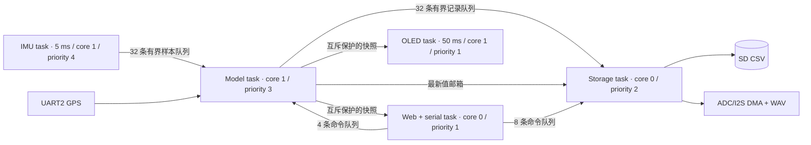

# ESP32 RTOS 迁移与状态机规划（v0.3.0）

本项目使用 PlatformIO 的 Arduino 框架，底层是 ESP32 FreeRTOS。本版把应用逻辑从 `loop()` 搬入明确的 FreeRTOS 任务，保留现有传感器与网页驱动。要整体换成 ESP-IDF 项目，可在任务边界稳定后再替换驱动；算法与状态机头文件不依赖 Arduino。

调度、优先级、队列、互斥、状态机和上板排障的系统讲解见 [RTOS 知识与本项目实践](RTOS_KNOWLEDGE_BASE.md)。

## 数据流与所有权



| 数据或外设 | 唯一写入方 | 其他任务如何使用 |
|---|---|---|
| MPU6050 与 I²C0 | IMU task | 采样按值入队，附 `micros()` 时间戳 |
| GPS UART、GPS/性能/姿态融合状态 | Model task | 网页和显示只读取快照 |
| SD、SPIFFS 录音与 WAV 状态 | Storage task | 控制命令入队；网页从状态快照读取 |
| OLED 与 I²C1、BOOT 按钮 | Display task | 只读取快照 |
| WebServer、串口命令 | Web task | 入队请求，立即回复“已排队”；后续查询结果 |

快照互斥锁仅用于内存复制，禁止持有时进行串口、I²C、文件或网络调用。文件系统锁隔离 SPIFFS 读写，不得由 IMU/Model task 获取。队列满时立即计数并丢弃新样本，不能让采集任务等待慢消费者。GPS 与 IMU 的采样时刻尚未同步到接收机时间；当前只是各自标记到达时间。日志是约 10 Hz 的融合快照，并非完整 200 Hz IMU 原始轨迹。

## 状态机

状态定义在 `src/runtime_state.h`，只由 Model task 根据观察到的事件推进，网页只负责展示。性能计时由独立的 `measurement::Timer` 处理，互不混用。

| 状态机 | 状态 | 进入/退出事件 | 动作或结果 |
|---|---|---|---|
| GPS | `no_signal` → `acquiring` → `fixed`；超时进入 `stale` | 收到 UART 字节；位置和速度同时有效；超过 1500 ms 无字节 | `fixed` 才能参与系统就绪判断；原始速度本身还需单独做 1500 ms 新鲜度检查 |
| 骑行 | `idle` → `riding` → `cooling` → `idle` | 有效速度 ≥5 km/h；速度 <2 或失效；冷却 30 s；恢复 ≥5 回 `riding` | 用于诊断。SD 自动记录沿用同样的 5/2 km/h 与 30 s 阈值，但仍有独立逻辑；后续可统一状态来源 |
| 系统健康 | `booting`、`ready`、`degraded` | 位置与速度有效，IMU 100 ms 内有采样；启动 10 s 后条件仍不满足 | `/diagnostics` 呈现状态；不代表导航精度已验证 |
| 录音 | `idle`、`active`、`paused`、`stopped`、错误字段 | 手动命令或速度触发；DMA/文件错误 | Storage task 独占状态与写盘，Web task 只入队和查询 |
| 性能计时 | 等待起步、加速、滚动 100–200、制动 | 原始 GPS 速度阈值穿越、断流、超时 | 测量核心独立回放测试；断流终止当前区间 |

状态转换不应由网页请求直接修改全局变量；网页产生事件，所有者任务执行转换。GPS 丢失不应清除已完成成绩，但当前测试需要取消。系统故障要留在诊断中，不能默默重启或把上一条 GPS 数据当成实时值。

## 迁移顺序与验收

1. 固定驱动边界与输入输出结构。已完成 IMU 样本队列、模型快照、存储命令队列和任务启动门；任务创建失败时不开采集。
2. 固定状态机与事件。已完成 GPS、骑行、健康状态及回放测试；下一步应让 SD 自动记录直接消费骑行状态，消除重复状态判断。
3. 隔离慢外设。已将 SD 和录音交给 Storage task，录音采样改为 ADC/I2S DMA；文件下载在录音中拒绝。仍需上板确认 DMA 原始值、WAV 时长和 SD 写盘时溢出计数。
4. 上板压力测试。分别运行 GPS、OLED、Web 高频轮询、SD、录音及其组合至少 30 分钟；记录队列丢弃、IMU 间隔 >10 ms、DMA 溢出、写失败、任务栈最低余量与堆剩余空间。为每项设定可接受阈值后再调整优先级和缓冲容量。
5. 收敛到一个产品状态来源。处理 GPS 模块差异与配置应答；必要时迁移至 ESP-IDF 原生组件，并替换 Web/音频驱动。迁移前保存可回放 NMEA 与 IMU 数据作为回归输入。

### 本地验证

```powershell
python test/run_replay.py
pio run
```

`/diagnostics` 显示三类状态、队列积压与丢弃数、任务栈余量、IMU 间隔、ADC DMA 溢出和存储写错误。这些是运行时观测值，不是通过构建即可得到的硬件验收结果。

### 已知限制

- Arduino/WebServer、SD、SPIFFS、I²C 与 ADC/I2S 的实际并发行为必须上板验证。仅有编译与本机回放，不能证明 200 Hz IMU、8 kHz 连续录音或定位精度。
- 录音状态的错误字段会记录 DMA 或写入失败，但 DMA 溢出计数是收到的事件数，不一定等于实际丢掉的样本数。
- 大文件下载虽然从网页任务执行，仍可能阻塞该任务；录音中拒绝下载。后续应改为分块传输和独立上传/下载策略。
- 当前串口 GPS 配置只发送 PMTK 请求，没有模块识别和应答验证；速度到达频率不等于导航频率。
- 车辆轴安装和重力补偿仍须标定。高频融合结果只供实验分析，不应作为安全控制依据。
